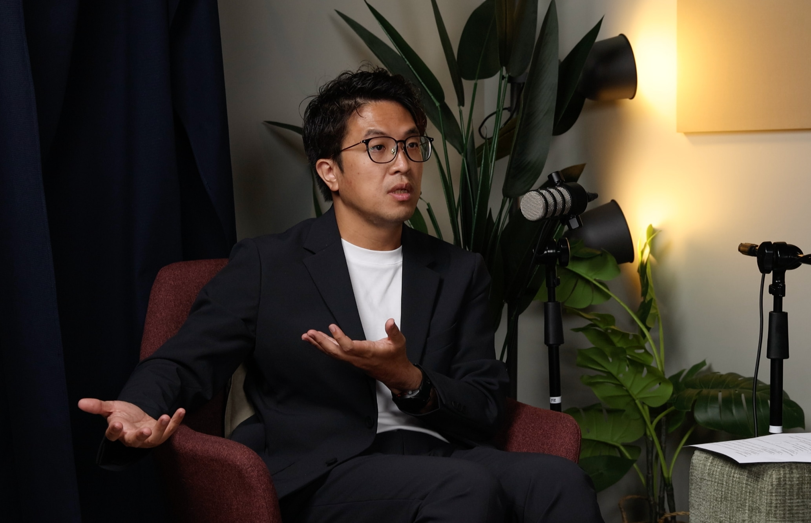
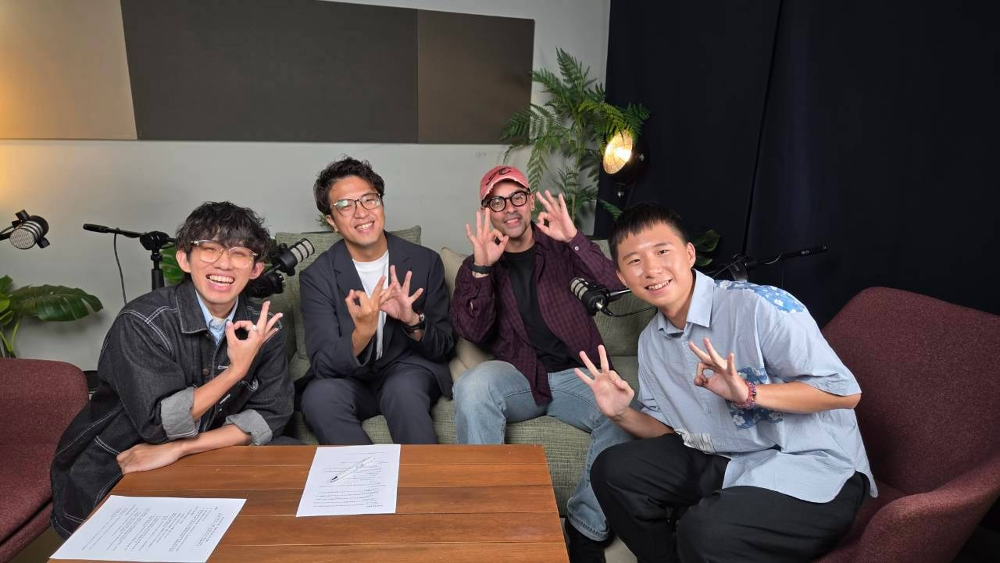

「老師會空氣投籃嗎？」「我會啊。」

原本直呼「戒慎恐懼」的三位主持人，意外找到共同話題。來到《新世紀直男戰士》的沈伯洋，說自己不只會對著空氣投籃，還會投球、揮棒；以前投完，甚至替自己配音。在他看來，這是一種紓壓方式，喜歡的人都可以做，不必限定是哪一種男人。

EP69 錄音時，沈伯洋以台北市長參選人的身分受訪。柏文、博志、孝成把問題從他的成長經驗，一路推向女性主義與城市政策：一個熟悉性別理論的人，是否就能避開日常偏見？如果連他都會漏看別人的處境，一座城市又能憑什麼保證，每個人都被看見？

## 懂得女性主義之後，為何還會說「我幫你」？

沈伯洋回憶，高中念男校時，接觸女生的機會少，甚至比較害怕與女性相處。直到大學課堂，他才接觸女性主義，對生理性別與社會性別的區分仍是似懂非懂。讀研究所後，概念才逐漸與生活接上。

最容易理解的入口，是家庭分工。為什麼爸爸應該做這個、媽媽應該做那個？看見女性承擔的壓力，也會發現男性被分配了另一套責任。一位主持人想起老師曾用電視遙控器說明家中權力：他回頭看，發現父親經常掌握遙控器，母親則一直在洗衣服。那些以前不值得注意的畫面，忽然有了不同的意思。

「我幫你帶小孩」「我幫你洗碗」，卻仍可能隨口說出。好意裡，很可能先把對方認定成應該負責的人。

沈伯洋也區分，同一句「幫忙」可能只是請另一半休息、由自己接手，不能只憑一個字斷案；要檢查的是，說話的人有沒有把事情當成共同責任。這也延續了節目對[體貼與性別腳本](/blog/ep2/)的追問。光知道哪些說法有問題，還不足以改變自己從小就熟悉的分工。

> 「你學到的知識跟你身體的習慣是很難一致的。」
>
> —— 沈伯洋，本集來賓

他曾向美國的老師抱怨，凡事都要反省實在疲憊。老師的回應，依他的轉述，是如果學過這些知識的人也放棄思考，世界只會變得更糟。他於是練習在說完一句話、做完一件事後，察覺欠考慮，再修正。時間拉長，原本需要刻意提醒的事情，才慢慢變得自然。

主持人進一步問起男性的原罪感。沈伯洋把生在既有結構中的處境，與個人造成傷害的責任分開，希望旁觀者把認識問題後的感受轉向行動。

但願意改變的人，仍得面對周圍的規則。他自己也曾因為找不到解方，想放棄繼續研究女性主義。

## 從「做什麼都不對」，到替組織撐出呼吸空間

沈伯洋赴賓州大學念法律碩士，原本打算多修智慧財產與公司法等課程，卻被女性主義課吸引。課堂從法律個案切入，討論女性如何被理解、被描繪，讓理論有了可以操作的對象。回台後，他選擇以女性主義寫碩士論文，研究女性身分與加害者、被害者形象之間的關係。

讓他沮喪的是，在當時接觸的部分後現代理論裡，打破一種刻板印象，可能又製造另一種；國家制定規則，背後仍有權力介入。他看見的問題越來越多，能做的事情卻越來越少。

轉折出現在法律社會學。沈伯洋逐漸把焦點移向組織：一家公司裡，誰掌握發言權？哪些習慣被默認？有人受到騷擾時，能向誰求助？外部社會已有的不平等，可能因為公司裡掌權的人不認為那是問題，進一步被放大。可是，同樣在這間公司裡，也能透過申訴管道、外部參與與處理程序，讓原本求助無門的人多一條路。這個分析尺度，讓他重新找到可著手改動的地方。

> 「但是你至少讓很多呼吸的空間被撐出來。」
>
> —— 沈伯洋，本集來賓

制度仍可能被掌權者利用，法律也不能一次消除所有不平等，他並未否認這些限制。但對身處其中的人而言，多一個申訴入口，就有具體差別。改革能否做下去，不必等到所有問題都有答案。

可是，組織裡的規則可以被指出，一條街上的不安，卻可能根本沒進入決策者的視線。

## 同一條街，誰能停留，誰只想快步通過？

沈伯洋想起在美國當助教的經驗：同樣帶課，一位英文比他好的女性學妹，卻更常面對學生挑戰。起初他考慮口音、國籍等因素，後來觀察其他女性助教的遭遇，才把性別放回分析。當時已在念博士的他，也意外於自己竟然不是第一時間就想到這個可能。

談吸菸空間時，又有人提醒他：如果裡面擠著一群男性，女性使用者可能不想走近。他才發覺自己再次漏想了。主持人接著談起小小的吸菸區，幾個人站進去就顯得擁擠；沈伯洋則提到透明的設計、可與其他人保持距離的位置。名義上人人都能使用的設施，會不會讓一部分人放棄進入，得走到現場才看得清楚。

他提出讓不同使用者參與安全審計，實地走過、指出不安。主持人追問：年齡、性別、身形與需求如此不同，實務上做得到嗎？

沈伯洋承認這會增加時間，也強調參與群體必須夠多元、定期檢查漏掉誰。安排一批人來體驗，還只是開始；連這批人是否具有代表性，也得繼續檢視。

> 「假設你有機會當市長，要怎麼解決這個搭訕的亂象？」

主持人把討論拉回中山區。面對路邊搭訕造成的不適，沈伯洋談的是如何讓拒絕更容易、讓人願意停留：友善的空間、可求助的商家，以及旁人能夠看見現場的條件。他認為，當人們只想快步離開，街道也失去彼此照看的機會。

但便利商店店員已經承擔那麼多工作，協助求救又由誰支持？主持人追問動機與資源，沈伯洋提出訓練、回報機制及獎勵工具的可能。從店員能做什麼、訊息要送去哪裡，到接獲回報後由誰處理，都得安排。僅有路人的善意，接不完這些工作。

## 警察多上一堂課，為什麼不一定更懂得尊重？

主持人以節目中談到的同志酒吧臨檢爭議，追問警察組織的陽剛文化。問題比要求一家企業調整更棘手：警察本身就是行使公權力的一環，如果偏見已融入日常笑鬧與執勤習慣，改變要從哪裡開始？沈伯洋把討論帶往組織如何定義「做得好」。

他認為上課有必要。但如果獎勵的只是出席、測驗或填完表格，組織鼓勵的就只是完成課程，未必是在現場尊重人。

他用公車駕駛舉例：當工作要求讓司機想多趕幾班，開車方式就會受影響；如果考核重視的是乘客感受到的平穩，司機的選擇也可能不同。警察的服務同樣可以從這個角度思考。他隨即補充，這不是直接主張把某種評分方式原樣採用，而是要檢查組織究竟在獎勵什麼行為，以及那套獎勵和服務對象的經驗是否相連。

主持人提出過往訪問警察心理議題的經驗：出了事情就增加講座或表格，最後反而加重第一線壓力。要照顧人的措施，若只是不斷往他身上疊任務，也可能成為新的負擔。

沈伯洋沒有把制度說成萬靈丹。他提醒，制度論容易把人想得太被動：改了考核，警察就一定照做嗎？每個人仍有自尊、保守的心情，也可能抗拒被要求改變。設計者得理解人的反應，才能調整規則。這讓他前面談的「做中學」多了一層限制：制度可以創造學習的機會，卻不能把人當成只對獎勵反應的零件。

照顧到人的感受，才有機會改變規則。話題轉向婚姻時，這個問題回到家庭：事情誰來做，時間又從哪裡來。

## 從洗碗槽回到城市：照顧者也需要被接住

沈伯洋回憶，自己曾問李茂生老師，應該與什麼樣的人結婚。依他的轉述，老師給的答案是找一位能相處一輩子的好朋友。他說，太太就是自己最好的朋友，但也認為彼此支持，並不只存在於婚姻裡。

說到家務，他喜歡洗碗與整理，太太喜歡煮菜。他說自己回家第一件事就是洗碗，因為把東西洗乾淨、擺整齊，讓他舒服；太太洗的時候，他甚至會嫌沒有自己乾淨。碰到兩人都不太愛的洗衣服，才需要再分：一人洗、一人晾。分工不全是一場抽象的平等辯論，也包含誰做得順、誰不喜歡，以及兩人都不想做的事情怎麼辦。這讓前面的「我幫你」，有了另一種說法：事情本來就需要一起安排。

但他也有安排不了的時候。

當立委時，他曾盡量先接孩子、陪家人吃飯，再回去工作；進入選舉後，卻有時一兩天見不到太太與女兒。願意分工是一回事，工作還留下多少時間，又是另一回事。

於是，他把喜歡與太太一起看電影、映後一起討論的日常，連到臨時托育的需要。不是每個家庭都能請祖父母或親友接手；若父母永遠只能輪流出門，兩人共同相處的時間便被擠掉。他提出讓家庭附近有更多可參與的活動、讓托育更有彈性的想法。這些構想的共同對象，是需要喘息與維持自身生活的人，也延續了節目對[家庭照顧與父權分工](/blog/ep60/)的討論。

> 「社工他就專門在接住別人，誰來接社工？」
>
> —— 沈伯洋，本集來賓

談孤獨政策時，他用這個問題說明政府應有的角色：讓人有互相陪伴的機會，並承擔最後一道防線。對他而言，場館、活動與設施的意義，要回到人如何使用、如何相處。陪伴也不限於有人坐在身旁；讓一個人更方便運動、讓照顧者有時間離開家，都可能是支持的形式。

訪談尾聲，主持人仍有一個問題：如果一直以女性為例，男性的需求在哪裡？

沈伯洋先提醒，談女性政策就自動想到育兒，本身可能再次綁緊性別分工。育兒應由不同性別共同承擔，組織也得讓男性請假照顧不再顯得反常。接著，他談到高風險工作中的男性安全，回憶熟識的人因工作意外離世。對話最後停在安全指引、工作條件，以及男性的身形與力氣是否在工作安排中得到考量。

---

沿著整場對談看，「[性別主流化](https://gendercoordinationandmainstreaming.unwomen.org/building-block/module-1-introduction)」提供了一個收束的角度：在各種政策與制度的設計、執行及評估中，就檢查不同性別及不同處境的人會受到什麼影響，而非等問題發生，才另加一項補救。從吸菸區到托育，女性主義在這裡也關乎身體如何使用空間、照顧如何被支持，以及哪些生活經驗有機會成為決策依據。把差異帶進討論，才可能知道一套看似相同的規則，讓誰方便，又把誰留在外面。

沈伯洋沒有在訪談中交出完成版的城市。主持人的問題仍在：誰能參與、誰承擔新增工作、指標會不會製造新的盲點。能否讓一位行人安心停留、一位家長空出兩小時、一位工人平安回家，還要靠具體設計與執行來回答。從改掉一句「我幫你」，走到讓照顧不再只靠某個人自覺，這段路需要的，是持續有人提出那些還沒被算進去的生活。
